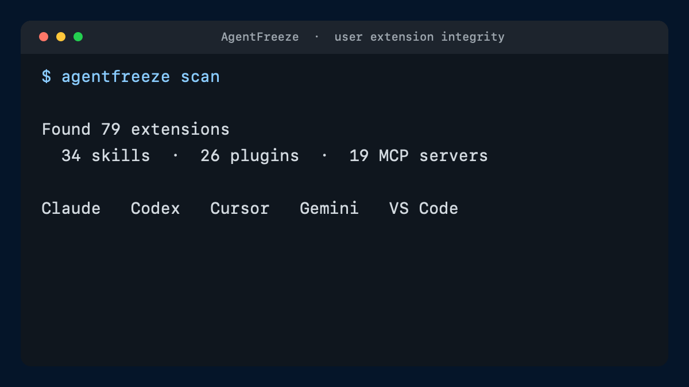

# AgentFreeze

**See what changed outside your agent dependency manager.**

[](https://github.com/skikkh/agentfreeze/actions/workflows/ci.yml)
[](LICENSE)
[](https://www.rust-lang.org/)

AgentFreeze is a local, no-exec evidence collector for Claude, Codex, Cursor, Gemini, and shared
agent directories. It inventories supported Skills, plugins, and MCP definitions without starting
them, records their exact observed state in `agentfreeze.lock`, then detects additions, removals,
and content changes.



```console
$ agentfreeze scan
Found 79 extensions: 34 skills, 26 plugins, 19 MCP servers

$ agentfreeze freeze
Frozen 79 extensions in agentfreeze.lock

$ agentfreeze verify
Verified 79 extensions — no drift

$ agentfreeze watch
Watching 79 user extensions every 60s — Ctrl-C to stop
```

The `79` above is one real maintainer machine, not an ecosystem average.

## Why

Coding agents now load executable or behavior-shaping material from many places:

- `~/.claude/skills`
- `~/.codex/skills` and the Codex plugin cache
- `~/.cursor/skills` and Cursor-managed `~/.cursor/skills-cursor`
- shared `~/.agents/skills`
- MCP definitions in Claude, Codex, Cursor, Gemini, VS Code, and project configs

Package managers and host controls can lock what they manage. They do not necessarily explain
files installed manually, copied by another tool, left in a cache, or changed after installation.
AgentFreeze gives supported user-level locations one deterministic, local baseline and a polling
monitor.

AgentFreeze is **not a malware scanner** and does not label an extension “safe.” It answers a
narrower, testable question:

> What changed in the supported local extension state since I froze it?

## Install

macOS and Linux (requires GitHub CLI with `gh attestation verify`):

```sh
curl --proto '=https' --tlsv1.2 -LsSf \
  https://github.com/skikkh/agentfreeze/releases/latest/download/install.sh | sh
```

From source:

```sh
cargo install --git https://github.com/skikkh/agentfreeze --tag v0.1.0 --locked
```

Windows users can download the `.zip` from
[GitHub Releases](https://github.com/skikkh/agentfreeze/releases).

Release binaries include SHA-256 checksums and GitHub build-provenance attestations. By default,
the installer requires GitHub CLI (`gh`) and binds verification to this repository, the release
workflow, the resolved tag and commit, and GitHub-hosted runners. To explicitly accept only the
same-origin release checksum when `gh` is unavailable:

```sh
curl --proto '=https' --tlsv1.2 -LsSf \
  https://github.com/skikkh/agentfreeze/releases/latest/download/install.sh |
  sh -s -- --allow-checksum-only
```

To verify the v0.1.0 installer before running it:

```sh
curl --proto '=https' --tlsv1.2 -fLsS \
  https://github.com/skikkh/agentfreeze/releases/download/v0.1.0/install.sh \
  -o install.sh
release_sha="$(git ls-remote https://github.com/skikkh/agentfreeze \
  'refs/tags/v0.1.0^{}' | cut -f1)"
test "${#release_sha}" -eq 40
gh attestation verify install.sh \
  --repo skikkh/agentfreeze \
  --signer-workflow github.com/skikkh/agentfreeze/.github/workflows/release.yml \
  --signer-digest "$release_sha" \
  --source-ref refs/tags/v0.1.0 \
  --source-digest "$release_sha" \
  --deny-self-hosted-runners
sh install.sh
```

## Quick start

```sh
# See what your agents can load
agentfreeze scan

# Freeze user-level extensions into ./agentfreeze.lock
agentfreeze freeze

# Exit 0 when clean, 1 on drift, 2 on an operational error
agentfreeze verify

# Keep polling; print only when the observed state changes
agentfreeze watch
```

To inspect the current repository without putting it in the user-profile lockfile:

```sh
agentfreeze scan --scope workspace
```

Use `--json` with `scan`, `freeze`, or `verify` for automation. `watch --json` emits one JSON object
per changed observation. `verify --quiet` is designed for hooks. AgentFreeze v1 deliberately
freezes only supported user-level locations; use Seal for project-local authorization and
Microsoft APM for declared project or global package state.

## What gets discovered

| Ecosystem | Skills | Plugins | MCP configs |
|---|---:|---:|---:|
| Shared `.agents` | yes | — | — |
| Claude | yes | installed plugin registry | user, project, desktop |
| Codex | yes | plugin cache | user and project TOML |
| Cursor | yes | — | user and project |
| Gemini | yes | extensions | user and project |
| VS Code | — | — | user and project |

Paths are stored as `$HOME/...` or `$WORKSPACE/...`; raw MCP definitions are never written to the
lockfile. Likely secret fields—including secret-like environment, header, CLI-flag, and URL-query
keys—plus URL credentials are redacted before hashing. Non-secret routing values such as tenant,
region, and mode remain covered by drift detection. An unrecognized low-entropy secret can still
influence the digest and may be vulnerable to offline guessing when the rest of its definition is
known. Review extension names and source locations before publishing a lockfile.

## Drift is explicit

```console
$ agentfreeze verify
Drift detected: 2 changes
  ~ modified  codex:skill:user:$HOME/.codex/skills/review
  + untracked claude:mcp-server:user:$HOME/.claude.json#/mcpServers/new-server
```

`verify` reports:

- `modified`: content or recorded provenance changed
- `missing`: a frozen extension disappeared
- `untracked`: a new extension appeared

## Deliberately not another package manager, scanner, or project lock

[Seal](https://sealfile.dev/) already defines a thoughtful project-local lockfile and load-time
authorization model. [Microsoft APM](https://github.com/microsoft/apm) already provides a
cross-agent dependency manager with project and global scope, content-hash lockfiles, audit, SBOM,
and CI policy. [Snyk Agent Scan](https://github.com/snyk/agent-scan) already provides local
security scanning plus centralized background monitoring. AgentFreeze does not reimplement those
product surfaces.

Use the tool that owns the question:

| Question | Tool |
|---|---|
| What declared packages should a project or global environment install and reproduce? | Microsoft APM |
| Which project-local bundles may load? | Seal |
| Does installed content look malicious, and how can a security team monitor it? | Snyk Agent Scan or another scanner |
| What changed in supported local state outside the manager, without starting extensions? | AgentFreeze |

AgentFreeze's differentiator is **not** merely “global scope”: APM already supports global locks,
and Snyk already supports background monitoring. The v0.1 experiment is specifically an offline,
no-exec baseline for discoverable state that may not be declared in a dependency manager.
AgentFreeze v1 refuses workspace entries in its lockfile. See the
[Seal boundary](docs/comparisons/seal.md) and
[existing-tool comparison](docs/comparisons/existing-tools.md).

## Security properties

- SHA-256 content digests with deterministic, length-prefixed hashing
- hidden files such as `.git` are included; v1 has no ignored-name list
- sorted inventory and deterministic JSON output
- no symlink traversal; internal link targets are hashed as text and extension-root links fail
- no network requests during scan, freeze, verify, or watch
- unreadable, malformed, broken, or boundary-escaping configured sources fail the operation
- lockfile paths are anchored instead of exposing the local username

AgentFreeze cannot protect a lockfile an attacker can also modify, judge first-install safety,
observe runtime behavior, or prevent a time-of-check/time-of-use race. Read the
[threat model](docs/threat-model.md) before using it as a security gate.

## Status

`v0.1` is an early, usable baseline:

- [x] cross-agent inventory
- [x] deterministic user-environment lockfile
- [x] drift verification and CI exit codes
- [x] bounded-interval polling monitor
- [ ] references to upstream-managed project state without format translation
- [ ] signed origin and provenance records
- [ ] native filesystem events and notification adapters
- [ ] evidence-led decision on whether runtime observation belongs here at all

The roadmap deliberately separates integrity from safety claims. See [ROADMAP.md](docs/roadmap.md).

## Interoperability before standardization

AgentFreeze is not a standard, and v0.1 is only a two-week demand test. Standardization remains a
no-go unless an existing host, package manager, or scanner consumes the output and at least one
independent implementation passes shared conformance fixtures. Until then, v1 is only a documented
reference format.

Changes to the format require an RFC, compatibility analysis, test vectors, and a migration path.
Vendor-neutral governance and compatibility with existing work are defined in
[GOVERNANCE.md](docs/governance.md).

## Contributing

New host detectors, adversarial fixtures, and specification feedback are welcome. Start with
[CONTRIBUTING.md](CONTRIBUTING.md). Security reports must follow [SECURITY.md](SECURITY.md).

[日本語 README](README.ja.md)
